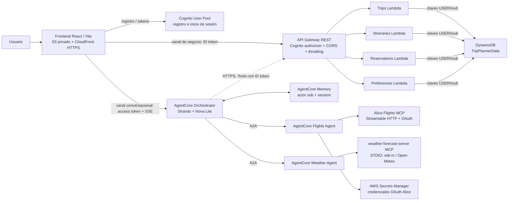

# Arquitectura, componentes y permisos

## Diagrama de arquitectura

El frontend también invoca la API de negocio directamente; el Orchestrator usa la misma API cuando el usuario solicita guardar o consultar datos desde el chat. El tráfico conversacional se transmite desde AgentCore y las búsquedas de vuelo/clima son consultas externas; no crean reservas automáticamente.

## Componentes y responsabilidades

| Componente | Responsabilidad |
|---|---|
| React/Vite | Interfaz, sesión Cognito, formularios y visualización de resultados. No contiene credenciales AWS. |
| S3 + CloudFront | Aloja los archivos estáticos. Bucket privado, OAC, HTTPS y fallback de rutas SPA. |
| Cognito | Registro e inicio de sesión; emite tokens de acceso e identidad. |
| API Gateway | API REST de negocio, valida Cognito, aplica CORS y throttling de etapa. |
| Lambdas | Validan campos y propiedad; leen/escriben solo la partición del usuario autenticado. |
| DynamoDB | Persiste viajes, itinerarios, reservas simuladas y preferencias. |
| AgentCore Orchestrator | Conversación SSE, memoria por actor/sesión, selección de Tools y delegación A2A. |
| Flights Agent | Consulta ofertas a Alice Flights MCP mediante OAuth. |
| Weather Agent | Consulta pronóstico a weather-forecast-server MCP sobre STDIO. |

## Canales y confianza

1. **Negocio:** navegador → API Gateway → Lambda → DynamoDB. Cada ruta de negocio requiere Cognito. El propietario se obtiene del `sub` verificado por API Gateway; no del JSON del cliente.
2. **Asistente:** navegador → AgentCore Orchestrator por HTTPS/SSE. AgentCore valida el access token en el endpoint `COGNITO`; el Orchestrator usa el `sub` validado para la memoria. Cuando una Tool necesita datos de negocio, reenvía el ID token a API Gateway en `X-TripPlanner-Business-Token`, que aplica su propio autorizador.
3. **Agentes especializados:** Orchestrator → Flights/Weather por A2A. Flights y Weather consultan sus MCP; sus resultados no se guardan automáticamente.

## Permisos IAM

### Funciones Lambda

Los roles de ejecución SAM reciben permisos limitados al ARN de la tabla `TripPlannerData`:

| Rol lógico | Acciones | Recurso |
|---|---|---|
| TripsFunction | `dynamodb:GetItem`, `PutItem`, `Query`, `UpdateItem` | Solo tabla de negocio |
| ItinerariesFunction | `dynamodb:GetItem`, `PutItem`, `UpdateItem` | Solo tabla de negocio |
| ReservationsFunction | `dynamodb:GetItem`, `PutItem`, `Query`, `UpdateItem` | Solo tabla de negocio |
| PreferencesFunction | `dynamodb:GetItem`, `PutItem` | Solo tabla de negocio |
| CorsFunction | Sin acceso a DynamoDB | Ninguno |

### Runtimes AgentCore

Los runtimes necesitan `bedrock:InvokeModel` sobre el modelo Amazon Nova Lite `us.amazon.nova-2-lite-v1:0`. Orchestrator necesita `bedrock-agentcore:InvokeAgentRuntime` acotado a los runtimes Flights y Weather configurados, y permisos de lectura/escritura sobre el recurso de AgentCore Memory configurado si se habilita `TRIP_MEMORY_ID`. Flights necesita `secretsmanager:GetSecretValue` y `secretsmanager:PutSecretValue` solo sobre el secreto OAuth de Alice. Weather no necesita secreto ni API key. Los roles de runtime no deben recibir permisos generales de DynamoDB: la persistencia de negocio pasa por la API autenticada.

En el despliegue de referencia, la política `InvokeSpecialistAgents` del rol Orchestrator permite `bedrock-agentcore:InvokeAgentRuntime` únicamente sobre los ARN de Flights y Weather. Los ARN concretos de AgentCore, memoria y secretos varían por entorno y deben restringirse a sus recursos; no se debe usar `Resource: "*"`. La plantilla SAM define los permisos Lambda; los roles administrados por AgentCore se configuran por separado. El repositorio no contiene el proyecto AgentCore que administra esos roles; después de publicar un runtime, vuelve a revisar la política porque un despliegue futuro podría restablecerla.

### Sitio web

El bucket tiene bloqueo de acceso público. Su política permite únicamente `s3:GetObject` a la distribución CloudFront asociada. La identidad que publica necesita permisos de despliegue de CloudFormation y escritura de objetos en el bucket; esos permisos pertenecen a la identidad de operador, no al navegador.

## Decisiones y límites

- Cognito protege la API; CORS solo controla qué orígenes pueden leer respuestas desde el navegador y no reemplaza autenticación.
- DynamoDB usa una sola tabla por simplicidad y consultas centradas en un usuario. No hay índices secundarios en el patrón actual.
- El throttling `10 rps / burst 20` es compartido por la etapa API Gateway, no cuota por usuario.
- Las reservas del alcance actual son `SIMULADA` o `PENDIENTE`; no se procesan pagos ni se confirma una compra real.
- Alice y las fuentes de clima son servicios externos: disponibilidad, límites y detalle dependen de ellos.
